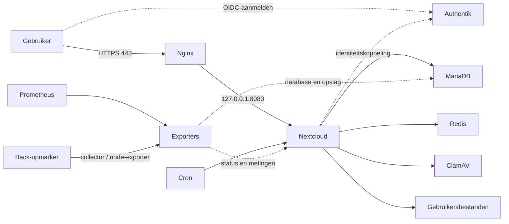
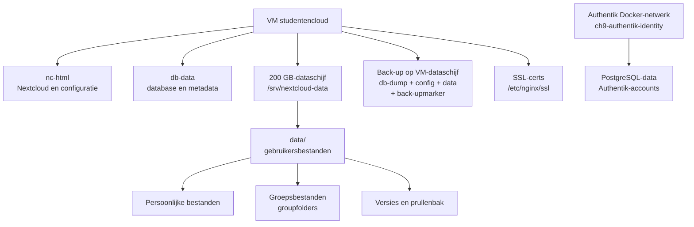

# Architectuur

Studentencloud draait op de Ubuntu-VM `studentencloud` met IP `10.20.254.141`.
Nextcloud gebruikt Docker Compose en een afzonderlijke 200 GB-dataschijf.

## Onderdelen

| Onderdeel | Functie |
|---|---|
| Nginx | HTTPS op poort 443; HTTP wordt doorgestuurd naar HTTPS |
| Nextcloud (`nc-app`) | Accounts, bestanden, delen en groepsmappen |
| MariaDB (`nc-db`) | Instellingen, rechten en bestandsmetadata |
| Redis (`nc-redis`) | Cache en bestandsvergrendeling |
| Cron (`nc-cron`) | Periodieke Nextcloud-taken |
| ClamAV (`nc-clamav`) | Malwarecontrole bij uploads |
| Authentik | Identiteitsdienst voor de OIDC-koppeling |
| Prometheus en exporters | Monitoring van applicatie en infrastructuur |

## Dataflow

## Opslag

Quota van 2 GB per gebruiker en 5 GB per groep zijn logische limieten in Nextcloud,
geen afzonderlijke partities. Persoonlijke bestanden, groepsbestanden, versies en
prullenbak delen de datamount `/srv/nextcloud-data/data`.

## Beheer

De app luistert op de host alleen op `127.0.0.1:8080`; Nginx publiceert HTTPS.
MariaDB en Redis publiceren geen hostpoort. Prometheus is alleen lokaal bereikbaar.
Authentik heeft eigen poorten en een afzonderlijk Docker-netwerk.

De huidige back-up staat op dezelfde VM. Zie [back-up en herstel](backup-restore.md)
en [monitoring](monitoring.md) voor beheer en beperkingen.
De Compose-bestanden staan in [infrastructure/](../infrastructure/install-notes.md).
