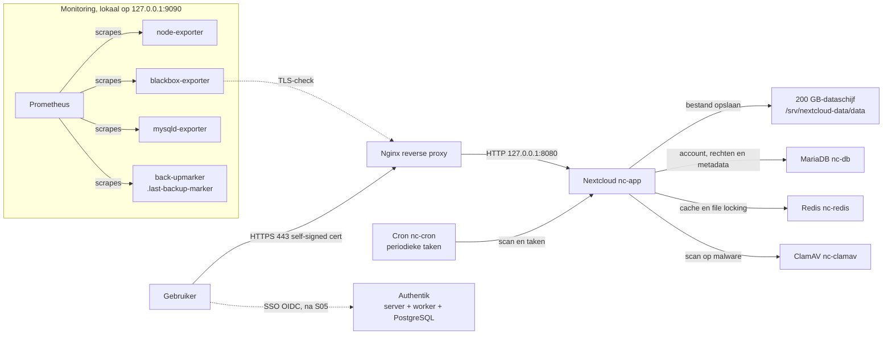
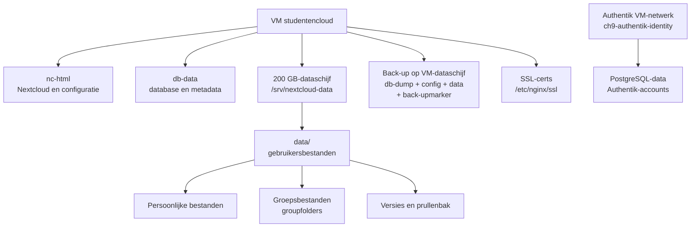

# Architectuur

Dit document toont eenvoudig hoe de Studentencloud is opgebouwd. Het bevat het
verplichte dataflowdiagram en storagediagram.

## Is dit werkelijk de huidige situatie?

Ja, voor de onderdelen die hier zijn getekend. De VM `studentencloud`
(`10.20.254.141`, Ubuntu Server 24.04, 200 GB-dataschijf) draait:

- de Nextcloud-stack (`nc-app`, `nc-db`, `nc-redis`, `nc-cron` en
  `nc-clamav`) via `infrastructure/docker/docker-compose.yml`;
- Nginx als reverse proxy met TLS (self-signed certificaat, M07); HTTP (80)
  redirecteert alles naar HTTPS (443);
- Authentik (server, worker, PostgreSQL en een OIDC-demo-client) via
  `infrastructure/authentik/docker-compose.yml`, op het afgezonderde
  netwerk `ch9-authentik-identity`;
- de monitoring-stack (node-exporter, blackbox-exporter, mysqld-exporter en
  Prometheus, lokaal op `127.0.0.1:9090`) via
  `infrastructure/docker/monitoring/compose.yml`;
- back-ups van database, configuratie en bestanden op de VM-dataschijf, met
  een back-upmarker die door de monitoring wordt opgevolgd.

In de audit van 13-11-2026 zijn deze onderdelen levend gecontroleerd; zie
`evidence/test-results/` voor het bewijs.

## De onderdelen in gewone taal

| Onderdeel | Eenvoudige uitleg |
|---|---|
| Nginx | Eindigt TLS (HTTPS) op poort 443 en doorgeeft naar Nextcloud; HTTP (80) redirecteert naar HTTPS. |
| Nextcloud | De website waar gebruikers inloggen en bestanden beheren. |
| MariaDB | Bewaart accounts, instellingen, rechten en informatie over bestanden. |
| Redis | Helpt Nextcloud sneller en voorkomt dat twee processen tegelijk hetzelfde bestand aanpassen. |
| Cron | Voert automatisch periodieke Nextcloud-taken uit. |
| ClamAV | Detectie van malware in bestanden die worden geüpload (files_antivirus). |
| Authentik | Identiteitsdienst (OIDC/SSO) met eigen PostgreSQL; afgezonderd van de Nextcloud-stack. |
| Monitoring (Prometheus) | Meet bereikbaarheid, opslag, database, certificaat, back-up en fouten; alleen lokaal op 9090 bereikbaar. |
| 200 GB-dataschijf | Bewaart de inhoud van gebruikers- en groepsbestanden. |
| `nc-html` | Bewaart de Nextcloud-installatie en configuratie. |
| `db-data` | Bewaart de MariaDB-database. |

## Dataflowdiagram

Dit diagram toont wat er gebeurt wanneer een gebruiker een bestand uploadt,
inclusief identiteit (Authentik), malwarecontrole (ClamAV) en monitoring.



In stappen:

1. De gebruiker opent Nextcloud via `https://10.20.254.141`; de Nginx-proxy
   eindigt TLS en doorgeeft naar Nextcloud (HTTP redirecteert naar HTTPS).
2. Nextcloud controleert het account en de rechten via MariaDB.
3. De inhoud van een upload gaat naar de 200 GB-dataschijf.
4. MariaDB bewaart wie de eigenaar is en waar het bestand bij hoort.
5. Redis ondersteunt cache en vergrendeling; cron voert achtergrondtaken uit.
6. Bij upload scant `files_antivirus` het bestand met ClamAV; malware wordt
   geweigerd (HTTP 415) en het tijdelijke uploadbestand verwijderd.
7. SSO via Authentik loopt over een apart netwerk en raakt de
   Nextcloud-containers niet (operationeel werk, zie S05).
8. Prometheus scrapes de exporters, voert HTTPS-bereikbaarheidscontroles uit en
   volgt de back-upmarker; het draait alleen op loopback (M11).

## Storagediagram



De persoonlijke quota van 2 GB en groepsquota van 5 GB zijn logische limieten
in Nextcloud. Het zijn geen aparte schijfpartities. Alle bestanden staan samen
op de 200 GB-dataschijf, maar Nextcloud houdt per gebruiker en groep bij hoeveel
ruimte gebruikt mag worden.

## Wat is er en wat staat er nog open?

Reeds aanwezig en getekend in de diagrams:

- reverse proxy (Nginx) met TLS via self-signed certificaat (M07);
- ClamAV voor malware-detectie (M09);
- monitoring van bereikbaarheid, opslag, database, certificaat en back-up
  (M11), alleen lokaal bereikbaar;
- Authentik voor SSO op een eigen netwerk (S05, operationeel werk loopt nog);
- back-ups van database, configuratie en bestanden met gemonitord
  voltooiingsmarker (M10).

Nog open, niet als bestaand voorgesteld:

- een **off-VM-beschermde, versleutelde back-uplocatie** (Restic/Borg) met
  retentieplanning; de huidige back-up staat op dezelfde VM-schijf;
- een off-VM-waarnemer of externe alert-ontvanger bij de monitoring;
- een complete applicatierestore-test in isolatie (incl. metadata, rechten en
  shares);
- afgeronde SSO-flow (login, logout, blijvende rolkoppeling).

## Hoe controleer je of het diagram klopt?

Voer op de VM uit:

```bash
cd infrastructure/docker
docker compose ps
docker compose exec app php occ status
docker compose exec app php occ config:system:get overwriteprotocol
findmnt /srv/nextcloud-data
df -h /srv/nextcloud-data
sudo nginx -t
curl -sSIIk https://10.20.254.141 | head -n 5
docker compose port db 3306
docker compose port redis 6379
```

Het diagram is bevestigd wanneer:

- `nc-app`, `nc-db`, `nc-redis` en `nc-cron` draaien;
- Nextcloud versie 35 rapporteert;
- `/srv/nextcloud-data` werkelijk op de 200 GB-schijf is gemount;
- MariaDB en Redis geen gepubliceerde hostpoort tonen;
- HTTPS (443) via Nginx werkt en HTTP (80) redirecteert naar HTTPS;
- een geüpload testbestand na `docker compose restart` nog aanwezig is.

Bewaar de uitvoer en screenshots in `evidence/test-results/` en
`evidence/screenshots/`.
